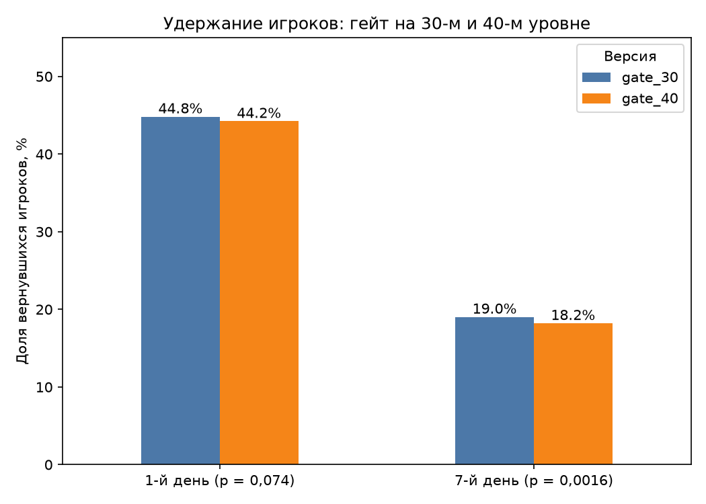

# Cookie Cats: A/B-тест положения гейта

## Вопрос
Стоит ли переносить первый гейт с 30-го уровня на 40-й?

## Данные
Открытый датасет Cookie Cats (Kaggle): 90 189 игроков, две группы
(gate_30, gate_40), число раундов за 1-ю неделю, возврат на 1-й и 7-й день.

## Ход работы
1. Загрузка данных в PostgreSQL (sql/01_schema.sql).
2. Исследование данных (sql/02_explore.sql):
   - найден выброс: игрок с 49 854 раундами (следующий — 2 961),
     исключён из анализа как аномалия; без него среднее число раундов
     в группах одинаковое (51,3);
   - 3 994 игрока (около 4 %) не сыграли ни одного раунда, оставлены в расчёте;
   - около 75 % игроков сыграли меньше 50 раундов.
3. Проверка баланса групп (notebook/analysis.ipynb):
   - в gate_30 — 44 700 игроков, в gate_40 — 45 489;
   - тест хи-квадрат: p = 0,0086, то есть расхождение, скорее всего, не случайно;
   - причина по данным неизвестна, выводы стоит читать с этой оговоркой.

## Результаты
Удержание на 1-й день: 44,82 % при гейте на 30-м уровне и 44,23 % при гейте на 40-м. Разница статистически не значима (p = 0,074).
Удержание на 7-й день: 19,02 % против 18,20 %. Разница значима (p = 0,0016): при гейте на 40-м уровне на 7-й день возвращается примерно на 4 % меньше игроков (в относительных цифрах).


### Сегменты по активности (разведочный анализ)

Игроки разделены по числу раундов за первую неделю. Удержание на 7-й день, %:

| Раундов | gate_30 | gate_40 |
|---------|---------|---------|
| 0       | 0,83    | 0,63    |
| 1–9     | 1,81    | 1,82    |
| 10–49   | 11,44   | 10,29   |
| 50–99   | 37,53   | 32,89   |
| 100+    | 71,14   | 71,03   |

Я сравнила группы отдельно внутри каждого сегмента. Заметная разница
в удержании на 7-й день нашлась у игроков, сыгравших 10–49 и 50–99
раундов: при гейте на 40-м уровне они возвращаются реже. У самых
неактивных (0–9 раундов) и самых вовлечённых (100+) разницы не видно.
Подробные значения p-value — в notebook/analysis.ipynb.

Возможное объяснение (гипотеза): гейт влияет на тех, кто успел
к нему приблизиться.

Оговорка: сегменты построены по поведению после начала теста, поэтому
результат описывает данные и не доказывает причину. Так как сравнений
было много, я использовала более строгий порог значимости
(поправка Бонферрони).

## Выводы
Рекомендация: не переносить гейт с 30-го уровня на 40-й. Данные указывают на возможное ухудшение удержания при переносе, по среднему числу раундов различий нет.

## Ограничения:
    - распределение по группам немного неравномерное (p = 0,0086), причина неизвестна;
    - мы не знаем, как гейт влияет на деньги (платежи), только на возврат игроков;
    - это один эксперимент на одной игре.

## Как запустить

Нужны: Python 3, PostgreSQL, датасет Cookie Cats.

1. Скачайте датасет `cookie_cats.csv` с Kaggle (поиск «Cookie Cats»)
   и положите в папку `data/`.
2. Установите библиотеки:
   ```bash
   pip install -r requirements.txt
   ```
3. Создайте базу данных в PostgreSQL:
   ```sql
   CREATE DATABASE cookie_cats_ab;
   ```
4. Подключитесь к базе и выполните `sql/01_schema.sql`, чтобы создать таблицу.
5. Загрузите данные (команда `psql`, путь замените на свой):
   ```sql
   \copy cookie_cats FROM 'data/cookie_cats.csv' WITH (FORMAT csv, HEADER true);
   ```
6. Запустите Jupyter и откройте `notebook/analysis.ipynb`:
   ```bash
   jupyter notebook
   ```
   В первой ячейке введите пароль от PostgreSQL. Если у вас другое имя
   пользователя, порт или база, измените их в ячейке подключения.
7. Выполните ячейки по порядку. SQL-запросы для исследования данных
   лежат в `sql/02_explore.sql`.